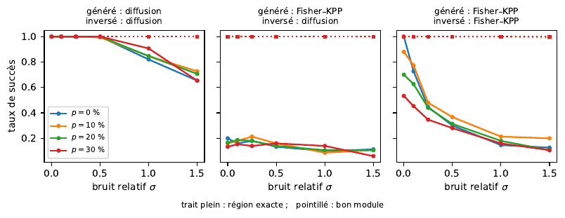
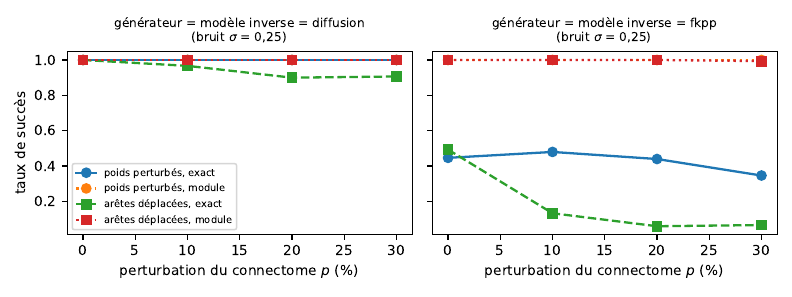

# Retrouver l'épicentre d'une maladie neurodégénérative

Projet de travaux dirigés, *Modélisation mathématique en neurosciences* (Master 2 Mathématiques, Université de Kinshasa, 2025-2026). Sujet 7.

**Auteur :** Vollmann Kabuya Bubanji

## Question

À partir d'une seule carte d'atrophie cérébrale, peut-on retrouver la région où la maladie a commencé, si la carte est bruitée, si le connectome est imparfait et si le modèle d'inversion n'est pas celui qui a produit les données ?

## Modèles

On travaille sur un connectome $G=(V,W)$ de $n$ régions, de laplacien $L = D - W$.

- **Diffusion en réseau** (Raj et al., 2012) : $x' = -\beta L x$.
- **Fisher–KPP sur réseau** : $x_i' = -\beta (Lx)_i + \alpha x_i (1 - x_i)$.
- **Graine** : $x(0) = \varepsilon e_s$. **Atrophie cumulée** : $a_s(t) = \int_0^t x(u)\,du$.
- **Estimateur de l'épicentre** : $\hat s = \arg\max_s \max_{t \in \mathcal T} \rho(a_s(t), a^{\mathrm{obs}})$, où $\rho$ est la corrélation de Pearson.

## Principaux résultats (données simulées, 80 régions)

- Le **module** de l'épicentre est retrouvé dans plus de 99 % des cas, dans toutes les conditions testées.
- La **région exacte** est retrouvée de façon fiable sous diffusion (100 % jusqu'à 50 % de bruit).
- Sous Fisher–KPP, la région exacte est sensible au bruit et surtout aux erreurs de topologie du connectome : 10 % d'arêtes déplacées font passer la réussite de 100 % à 15 %.

## Figures





## Contenu

| Fichier | Rôle |
|---|---|
| `tp7.py` | Code de départ fourni dans le cours (TP 7) |
| `sujet7.py` | Simulations : diffusion, Fisher–KPP (RK4), problème inverse, robustesse, loi a posteriori, figures |
| `sujet7_notebook.ipynb` | Notebook SageMath : calculs exacts et reproduction de toutes les figures |
| `verif_sympy.py` | Vérification des calculs exacts avec SymPy (sans SageMath) |
| `figures/` | Figures produites par `sujet7.py` |

## Installation et exécution

```bash
pip install -r requirements.txt
python3 sujet7.py            # environ 4 minutes, crée figures/ et affiche les tableaux
python3 verif_sympy.py       # vérifications symboliques
```

Sous SageMath, ouvrir `sujet7_notebook.ipynb` avec le noyau SageMath et exécuter toutes les cellules.

La graine aléatoire globale est fixée à 2026 : les résultats sont reproductibles.

## Utiliser un vrai connectome

Les fonctions de `sujet7.py` acceptent n'importe quelle matrice de poids `W` symétrique et positive :

```python
import numpy as np
from sujet7 import laplacien, spectre, epicentre_diffusion
W = np.loadtxt("mon_connectome.csv", delimiter=",")
s_hat, scores = epicentre_diffusion(spectre(laplacien(W)), a_obs)
```

## Limites

Connectome synthétique à 4 modules, données simulées, une seule graine, bruit indépendant entre régions. L'application à des données réelles (connectomes HCP, cartes d'atrophie OASIS ou ADNI) reste à faire.

## Références

- A. Raj, A. Kuceyeski, M. Weiner, *A network diffusion model of disease progression in dementia*, Neuron 73 (2012) 1204–1215.
- H. Braak, E. Braak, *Neuropathological stageing of Alzheimer-related changes*, Acta Neuropathologica 82 (1991) 239–259.
- S. Fornari et al., *Prion-like spreading of Alzheimer's disease within the brain's connectome*, J. R. Soc. Interface 16 (2019) 20190356.

## Licence

Code sous licence MIT (voir `LICENSE`), à l'exception de `tp7.py`, qui provient des notes de cours de C. D. Bope, R. Galekwa et S. Gihoma Abraham (Université de Kinshasa).
